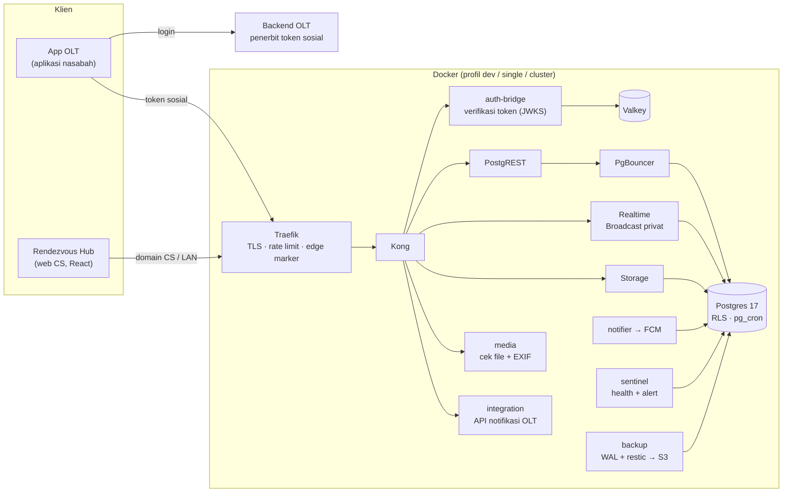

<div align="center">

# Rendezvous Community — Backend

**Server fitur komunitas, chat realtime, dan layanan nasabah untuk Rendezvous Online Trading**


</div>

---

Repo ini berisi seluruh sisi server fitur sosial aplikasi OLT, dari database sampai web back office:
- **Database dan API:** Supabase self-hosted (Postgres, PostgREST, Realtime, Storage). Logika bisnis ada di migrasi SQL, dilindungi RLS, dan diuji pgTAP.
- **Layanan Go:** auth-bridge, media gateway, push notifier, integrasi OLT, dan layanan pendukung lain.
- **Rendezvous Hub** (`apps/cs-console-react`): web untuk CS, Super Admin, dan Kepatuhan.

> **Batas integrasi.** Server sosial tidak pernah memanggil sistem OLT. OLT menerbitkan *token sosial* bertanda tangan, dan server memverifikasinya secara lokal. Order, daftar dan harga saham, portofolio, serta data nasabah tetap milik OLT. Rinciannya di [docs/olt-integration.md](docs/olt-integration.md).

## Daftar isi

- [Arsitektur](#arsitektur)
- [Isi repo](#isi-repo)
- [Mulai cepat](#mulai-cepat)
- [Pengujian](#pengujian)
- [Target `make`](#target-make)
- [Produksi](#produksi)
- [Dokumentasi](#dokumentasi)
- [Keamanan](#keamanan)

## Arsitektur



- **Login tunggal.** App menukar token sosial OLT di `POST /bridge/v1/exchange`. auth-bridge memeriksa tanda tangannya dengan kunci publik OLT, tanpa memanggil OLT, lalu mengembalikan JWT Supabase berumur 15 menit yang diperbarui otomatis.
- **Realtime.** Pesan chat disiarkan dari database lewat Broadcast ke topik privat `room:<id>` dan `user:<id>`, dan otorisasinya lewat RLS `realtime.messages`. Klien mengisi celah dari horizon terakhir yang dikonfirmasi server, dan typing di room besar diringkas server.
- **Profil deploy.** Image, nama service, dan env sama di semua profil:

  | Profil | Kegunaan |
  |---|---|
  | `dev` | Laptop: `http://localhost:8000`, Studio, token mock, CORS terbuka |
  | `single` | Produksi satu server: HTTPS Let's Encrypt, hanya path API publik, Studio mati |
  | `cluster` | Docker Swarm multi-node ([docs/scaling.md](docs/scaling.md)) |

## Isi repo

| Folder | Isi |
|---|---|
| [`supabase/`](supabase/) | Migrasi SQL bernomor (`0001`–`0107`), seed development, 87 file tes pgTAP |
| [`docker/`](docker/) | Compose + overlay per profil, Traefik, Kong, PgBouncer, secrets. Semua image di-pin tag + digest |
| [`services/`](services/) | Layanan Go: [`auth-bridge`](services/auth-bridge/), [`media`](services/media/), [`integration`](services/integration/), [`notifier`](services/notifier/), [`link-preview`](services/link-preview/), [`classifier`](services/classifier/), [`janitor`](services/janitor/), [`sentinel`](services/sentinel/), [`backup`](services/backup/), [`nasabah-gateway`](services/nasabah-gateway/), dan [`dummy-olt`](services/dummy-olt/) (OLT tiruan, hanya dev/test) |
| [`apps/cs-console-react/`](apps/cs-console-react/) | **Rendezvous Hub**: tiket & chat CS, Super Admin, Kepatuhan, Komunitas, Kesehatan sistem |
| [`tests/`](tests/) | Alat uji keamanan, beban (k6), dan chaos ([docs/testing](docs/testing/README.md)) |
| [`docs/`](docs/) | Integrasi, produksi, desain per fitur, laporan uji |

## Mulai cepat

**Prasyarat:**
- Docker dengan Compose v2.24+. Semua backend, migrasi, seed, dan tes berjalan di container.
- Windows memakai `.\make.ps1 <target>`, sedangkan Linux/macOS/VPS memakai `make <target>`.

```bash
make gen-secrets        # docker/secrets/ + docker/.env (aman diulang)
make up DUMMY_OLT=1     # semua service + migrasi otomatis + OLT tiruan
make seed               # user, post, thread, chat contoh
make smoke-dummy        # cek end-to-end lewat Kong
make cs-console-react   # Rendezvous Hub di http://localhost:8085
```

| Alamat (dev) | Isi |
|---|---|
| `http://localhost:8000` | API gateway (dipakai aplikasi nasabah) dan Studio |
| `http://localhost:8085` | Rendezvous Hub (web CS) |
| `http://10.0.2.2:8000` | API dari emulator Android |

- **Akun dummy:** semuanya memakai password `olt12345`. Akun 1001–1006 sama dengan user seed `budi_santoso`, `sari_invest`, `andi_trader`, `rina_saham`, `dewi_cuan`, dan `olt_official`. Daftar lengkapnya di [services/dummy-olt](services/dummy-olt/README.md).
- **Akun staf Hub dev:** dibuat oleh `make cs-staff` (otomatis saat `make cs-console-react`; tersimpan di `scripts/cs-demo/runtime/staff.json`).

## Pengujian

| Lapisan | Perintah | Isi |
|---|---|---|
| Database | `make test-db` | pgTAP: skema, RLS, RPC, realtime, chat CS, moderasi, privasi, rate limit |
| Go | `make test` (+ `test-<layanan>`) | Unit test semua layanan di container, `check-go-comments` |
| End-to-end | `make smoke-dummy`, `make smoke-cs` | Login token sosial, exchange, chat CS dari buka tiket sampai rating |
| Web | `make test-cs-console`, `make e2e-cs-console` | Lint, typecheck, unit, build, ukuran bundle, lisensi; Playwright |
| Keamanan | `make test-security`, `make scan-deps` | Probe otorisasi, routing produksi, konfigurasi edge, CVE dependensi & image |
| Beban & chaos | `make load-test P=step`, `make chaos-test` | k6 pembukaan pasar, API integrasi, Realtime/DB/PgBouncer dimatikan di bawah beban |

Hasil uji pra-produksi terakhir ada di [docs/testing/report-2026-11-03.md](docs/testing/report-2026-11-03.md).

## Target `make`

Daftar lengkapnya muncul dengan `make help` atau `.\make.ps1 help`.

| Kelompok | Target |
|---|---|
| Stack | `up`, `down`, `ps`, `logs s=<service>`, `reset CONFIRM=yes`, `migrate`, `seed`, `psql` |
| Rahasia & kunci | `gen-secrets`, `anon-key`, `cs-bootstrap-admin EMAIL=… NAME="…"` |
| OLT tiruan | `up DUMMY_OLT=1`, `dummy-token U=<user>`, `smoke-dummy` |
| Web | `cs-console-react`, `cs-staff`, `cs-demo`, `test-cs-console` |
| Backup | `backup`, `restore FILE=… CONFIRM=yes`, `backup-snapshots`, `restore-pitr AT=…` |
| Uji lanjutan | `test-security`, `scan-deps`, `load-test`, `load-integration`, `chaos-test`, `loadtest-cleanup`, `secrets-scan` |

## Produksi

```bash
make gen-secrets PROFILE=single
make up PROFILE=single CS=1      # CS=1 menyalakan Rendezvous Hub di domain CS (LAN/VPN)
```

Langkah lengkapnya ada di [docs/PRODUCTION.md](docs/PRODUCTION.md): domain dan TLS, secrets, batas & rate limit, alert kapasitas, backup dan PITR, urutan rilis dan versi minimum aplikasi, serta checklist go-live.

Konfigurasi operasional dikelola Super Admin dari **Rendezvous Hub**, dengan jejak audit, bukan dari file di server. Contohnya kunci Firebase, tujuan backup, kanal alert, alamat csAdmin, API key integrasi, dan versi minimum aplikasi.

## Dokumentasi

| Dokumen | Isi |
|---|---|
| [olt-integration.md](docs/olt-integration.md) | Kontrak token sosial untuk tim backend OLT |
| [integration/](docs/integration/README.md) | API notifikasi OLT (`/integration/v1`) |
| [dev-server.md](docs/dev-server.md) | Server development untuk integrasi aplikasi client: spek, port, domain, pemasangan |
| [PRODUCTION.md](docs/PRODUCTION.md) | Deploy, operasional, rilis, checklist |
| [scaling.md](docs/scaling.md) | Profil deploy dan migrasi single → cluster |
| [social/](docs/social/README.md) | Feed, chat, realtime, gap-fill, typing, pratinjau room |
| [cs-chat/](docs/cs-chat/README.md) | Chat CS, tiket, matching engine, `cs_api` |
| [community/](docs/community/), [nasabah/](docs/nasabah/), [push/](docs/push/), [backup/](docs/backup/README.md), [system-health/](docs/system-health/README.md), [evidence/](docs/evidence/) | Desain per fitur |
| [content-safety.md](docs/content-safety.md) | Kata terlarang, NSFW, karantina bukti |
| [testing/](docs/testing/README.md) | Cara menjalankan uji keamanan/beban/chaos dan laporannya |

## Keamanan

- **Akses data.** RLS aktif di semua tabel dan anon tidak punya hak. Helper `security definer` ada di schema `private`, yang tidak diekspos PostgREST.
- **Staf CS** hanya bisa memakai API, Realtime, dan Storage lewat domain CS. Di domain publik token staf ditolak (penanda `X-Olt-Edge`).
- **Rahasia** disimpan sebagai Docker secrets (`docker/secrets/`), tidak di `.env` maupun `docker inspect`. Kredensial operasional disimpan di Supabase Vault.
- **Container** read-only, `cap_drop: ALL`, `no-new-privileges`, non-root, dan punya batas CPU/memori. Network dipisah `edge` / `app` / `data` / `egress`, dan hanya Traefik yang membuka port.
- **Integritas konten:**
  - rate limit per aksi di database;
  - `client_id` idempoten;
  - filter kata dan NSFW;
  - persetujuan dokumen hukum;
  - sanksi bertingkat dengan banding;
  - arsip regulator dengan *legal hold*.
- **Privasi (UU PDP):** ekspor data dan hapus akun mandiri, retensi otomatis, dan akses data pribadi tercatat.

## Lisensi

Proprietary untuk Rendezvous OLT. Dependensi aplikasi berlisensi permisif (MIT/BSD/Apache-2.0/ISC). Komponen Supabase, Kong, Traefik, PgBouncer, Valkey, dan Postgres berjalan sebagai service terpisah.
