# Daftar Fitur OLT Social dan Rendezvous Hub

Ringkasan semua fitur komunitas di aplikasi nasabah, fitur Rendezvous Hub untuk staf, layanan server pendukung, dan titik integrasi ke aplikasi OLT. Kondisi per 17 November 2026.

Sistem ini tidak memakai iklan pihak ketiga. Promosi ke nasabah dilakukan lewat **Banner & Popup promo** dan **Kampanye notifikasi**, keduanya diatur dari Hub.

Fitur bertanda *(dijeda)* sudah ada di kode tetapi sedang disembunyikan dan bisa diaktifkan lagi bila dibutuhkan.

Gambar diambil dari aplikasi Rendezvous OLT (Windows) dan Rendezvous Hub di server development, jadi isinya data uji.

## 1. Aplikasi nasabah (library `rendezvous_community`)

### 1.1 Stream dan postingan

| Fitur | Deskripsi singkat |
|---|---|
| **Stream (feed)** | Feed umum (Terbaru / Mengikuti), feed per saham, hashtag, dan tab filter per indeks |
| **Postingan** | Tulis post dengan gambar, polling, sentimen bullish/bearish, dan `$KODE` saham. Bisa diedit 15 menit, draf tersimpan otomatis |
| **Komentar** | Thread berantai, mention `@user`, dan urutan komentar yang bisa diganti |
| **Kontrol komentar** | Pemilik post bisa mematikan komentar atau membatasi siapa yang boleh berkomentar (semua orang, yang diikuti, pengikut, atau keduanya), sebagai pengaturan akun maupun per post. Di pengaturan juga ada saklar untuk mematikan komentar di semua postingan sekaligus |
| **Pengaturan mention** | Pengguna memilih siapa yang bisa menyebut dirinya: semua orang, hanya yang ia ikuti, atau tidak ada. Mention dari orang yang tidak diizinkan tidak memberi notifikasi, dan namanya tidak muncul di saran `@` orang itu |
| **Trending & pencarian** | Saham, hashtag, dan post yang sedang ramai, serta pencarian user, post, dan saham |
| **Bookmark** | Simpan post untuk dibaca nanti |
| **Link preview** | Pratinjau tautan; tautan berbahaya atau NSFW disaring |
| **Profil & ikuti** | Profil sosial, ikuti/berhenti ikuti, daftar pengikut dan yang diikuti |
| **Akun resmi** | Akun resmi OLT bertanda khusus, hanya bisa diikuti, tidak bisa di-DM |

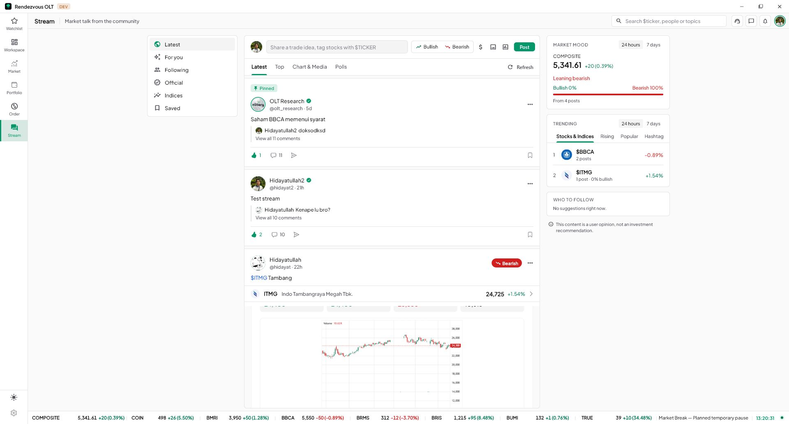
*Menu Stream: filter di kiri, postingan resmi tersemat, kartu saham, dan panel Market Mood serta Trending di kanan.*

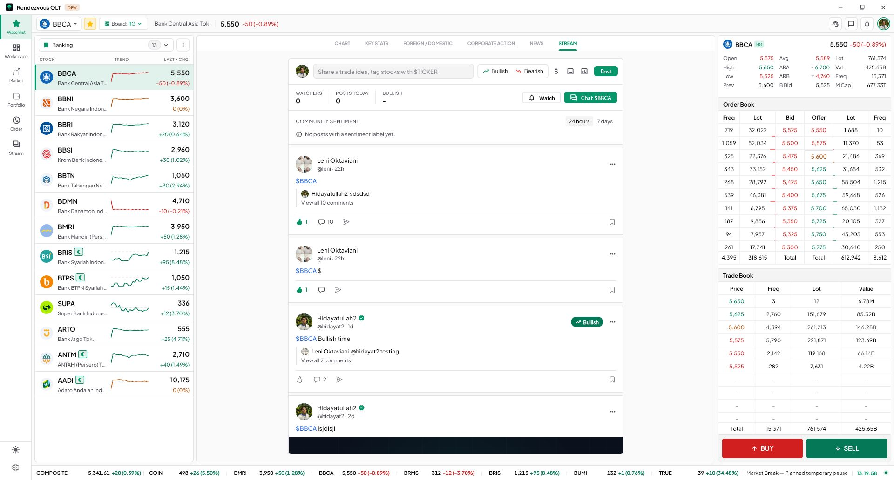
*Tab Stream di halaman saham BBCA: tulis postingan dengan sentimen, tombol Watch, dan Chat $BBCA ke room saham.*

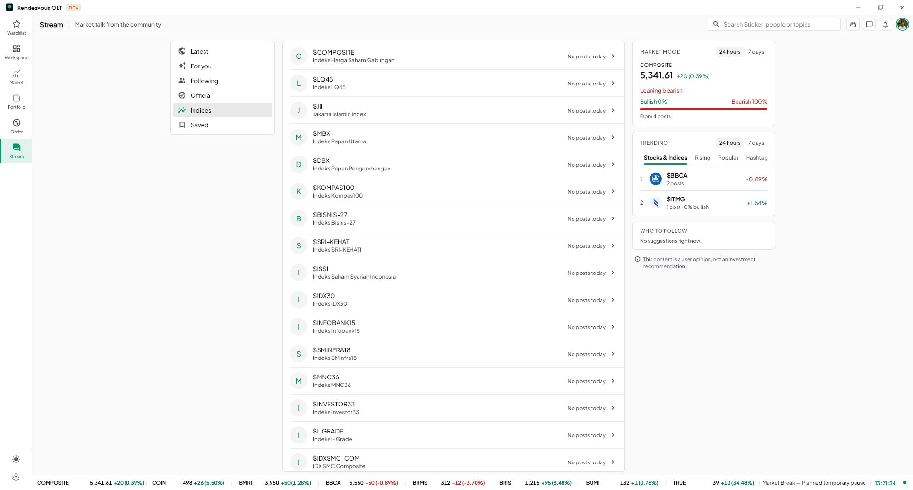
*Filter Indeks di Stream: daftar indeks OLT, masing-masing membuka feed indeks tersebut.*

### 1.2 Chat

| Fitur | Deskripsi singkat |
|---|---|
| **Chat DM** | Pesan pribadi realtime dengan centang ala WhatsApp, balas, reaksi, edit/hapus, dan indikator mengetik |
| **Permintaan pesan** | DM dari orang asing masuk ke "Permintaan pesan" dulu; bisa diterima, ditolak, atau diblokir |
| **Grup** | Peran owner, admin, dan member. Admin mengatur info grup dan bisa membuat grup hanya-admin yang boleh kirim |
| **Room saham** | Ruang chat per saham dengan slow mode, pesan tersemat, dan moderator room. Mention `@user` dan `$KODE` aktif di room saham. Di grup hanya mention ke sesama anggota grup; di DM dan chat CS keduanya tampil sebagai teks biasa |
| **Kartu saham di chat** | Kirim sampai 3 kartu saham; nama dan harga diambil dari data OLT |
| **Hapus chat/grup, edit pesan** | Sembunyikan chat, keluar grup, dan edit pesan (riwayat edit tercatat) |

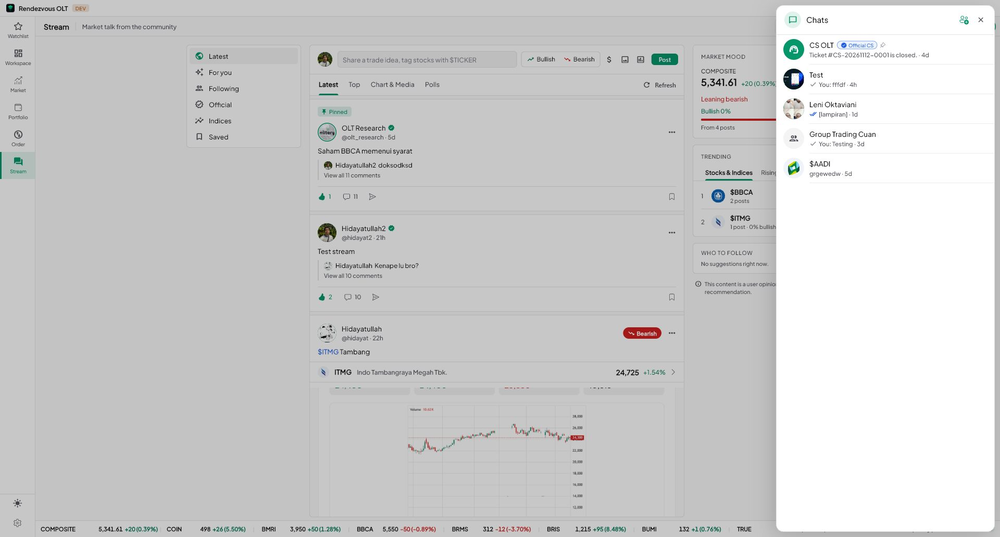
*Panel Chat: room CS OLT resmi selalu di paling atas, lalu DM, grup, dan room saham.*

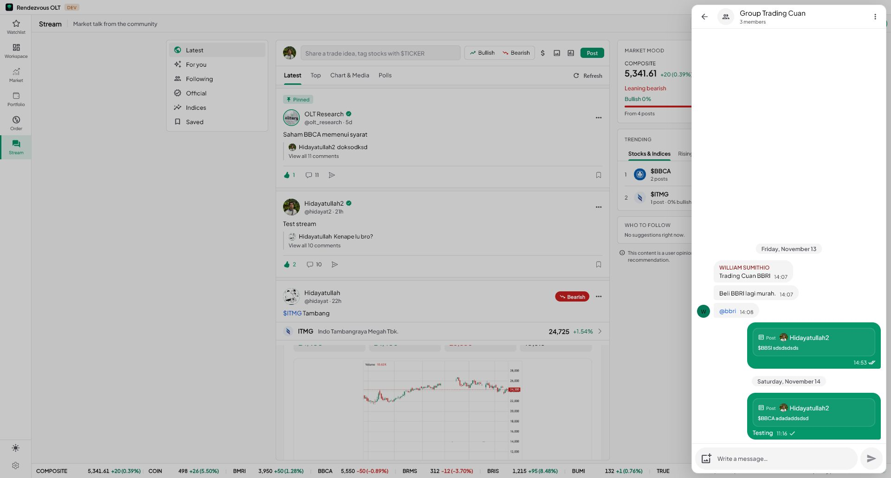
*Chat grup: mention sesama anggota, postingan yang dibagikan ke chat, dan centang terkirim/dibaca.*

### 1.3 Layanan nasabah

| Fitur | Deskripsi singkat |
|---|---|
| **Chat CS** | Room CS resmi di paling atas: lampiran gambar dan PDF, pertanyaan awal per topik, perkiraan waktu tunggu, saran balasan, rating, dan unduh transkrip |
| **Pusat Bantuan (FAQ)** | Artikel dua bahasa dengan kategori, pencarian, "Apakah ini membantu?", dan saran artikel sebelum chat CS. Tetap bisa dibuka saat offline |
| **Status gangguan** | Banner pengumuman gangguan di chat CS dan Pusat Bantuan |
| **Pengaduan tamu** | Nasabah yang tidak bisa login bisa mengadu dari halaman login, tanpa sesi dan tanpa OTP |

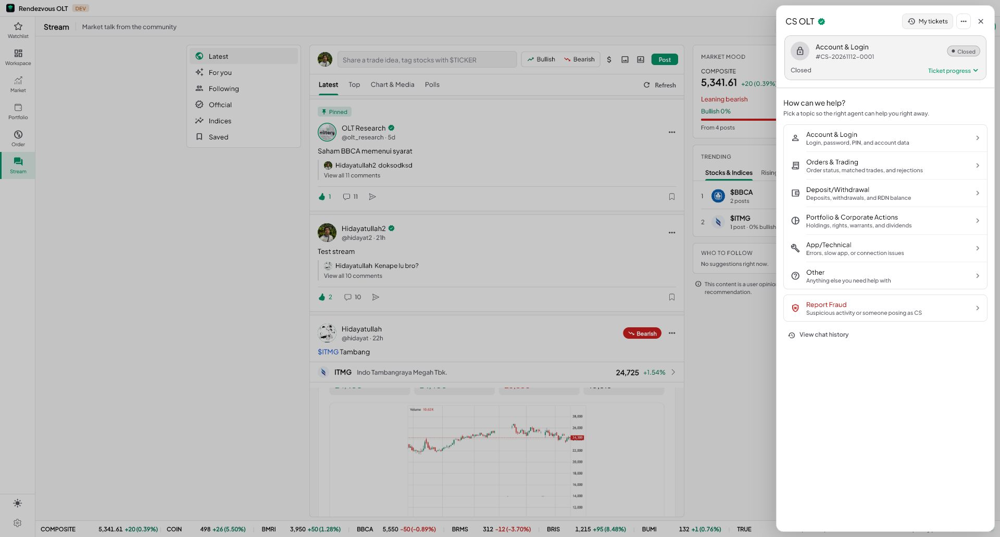
*Panel CS OLT: status tiket terakhir, pilihan topik, Laporkan Penipuan, dan riwayat chat.*

### 1.4 Notifikasi dan promosi

| Fitur | Deskripsi singkat |
|---|---|
| **Notifikasi** | Kotak notifikasi dengan badge, push komunitas, push transaksi OLT, ringkasan watchlist harian, preferensi per jenis, dan jam tenang |
| **Banner & Popup promo** | Banner strip di atas feed dan popup promo di tengah layar, dengan frekuensi sekali, harian, atau setiap buka aplikasi |

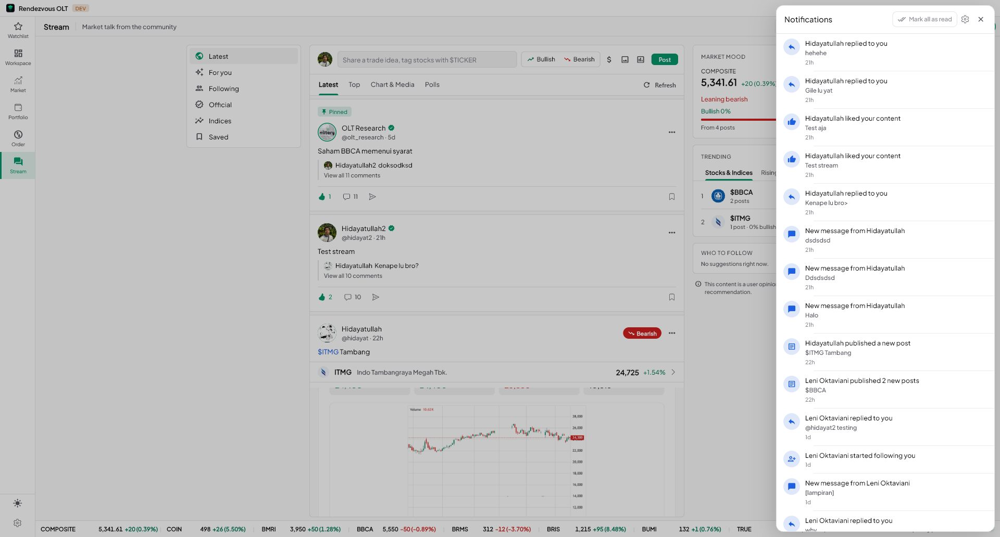
*Panel Notifikasi: balasan, like, pesan baru, postingan dari yang diikuti, dan pengikut baru.*

### 1.5 Keamanan, privasi, dan lainnya

| Fitur | Deskripsi singkat |
|---|---|
| **Moderasi & banding** | Laporkan konten atau user, blokir, lihat "Konten yang dimoderasi", dan ajukan banding atas sanksi |
| **Dokumen hukum** | Persetujuan S&K, Pedoman Komunitas, dan Kebijakan Privasi; aksi yang tertunda diulang otomatis setelah setuju |
| **Privasi & akun** | Atur siapa yang boleh DM, preferensi notifikasi, dan hapus akun komunitas |
| **Offline** | Cache lokal per user, dan pesan teks yang gagal terkirim dikirim ulang otomatis |
| **Kill switch & versi minimum** | Fitur sosial bisa dimatikan dari server (chat CS tetap jalan), dan aplikasi bisa dipaksa update |
| **Kustomisasi tampilan** | Tema mengikuti aplikasi OLT. Bubble chat, kartu post, badge, dan ikon bisa diganti |
| **Analitik** | Event anonim seperti buka feed, buat post, ketuk saham, dan klik order dari sosial. Isi teks tidak pernah dikirim |
| **Berbagi Trade** *(dijeda)* | Trader yang disetujui Kepatuhan membagikan order yang sudah match ke pelanggannya |

## 2. Rendezvous Hub (web staf)

### 2.1 Layanan nasabah

| Menu | Deskripsi singkat |
|---|---|
| **Layanan Nasabah** | Antrean tiket (Terbuka, Tiket saya, Selesai hari ini, Semua aktif). Staf bisa mengambil, membalas, melampirkan file, memberi label, dan menutup tiket, termasuk pengaduan tamu |
| **Dashboard** | Pantauan live: tiket terbuka, tunggu terlama, CS online, dan tiket yang perlu perhatian. Supervisor dan Super Admin hanya memantau |
| **Akun Nasabah** | Lihat dan bantu akun nasabah OLT (misalnya status dan reset) lewat gateway csAdmin resmi, khusus akun CS |
| **Pusat Bantuan → Topik** | Topik chat CS: ikon, urutan, pertanyaan awal, saran balasan, dan SOP |
| **Pusat Bantuan → Artikel bantuan** | Artikel Pusat Bantuan dua bahasa dengan gambar, statistik dibaca, dan nilai membantu |
| **Laporan** | Laporan per nasabah, kinerja CS, dan statistik FAQ. Bisa diekspor ke CSV |

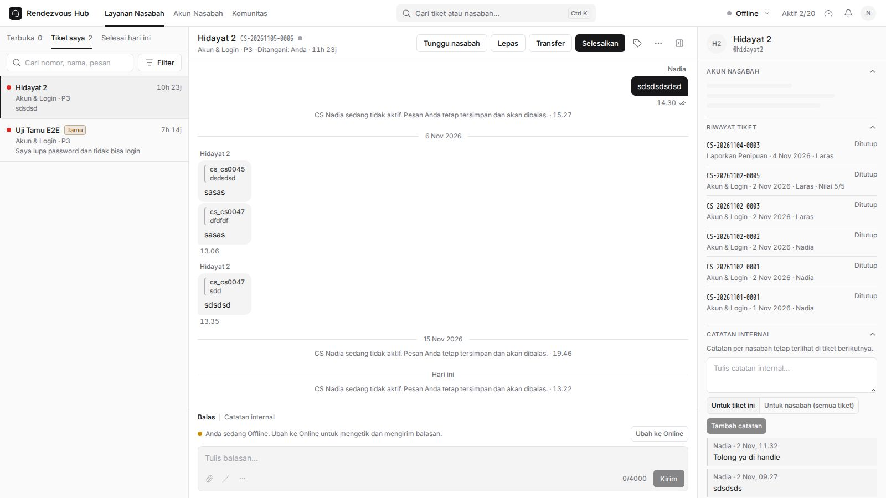
*Layanan Nasabah: daftar tiket di kiri, percakapan di tengah, serta akun, riwayat tiket, dan catatan internal nasabah di kanan.*

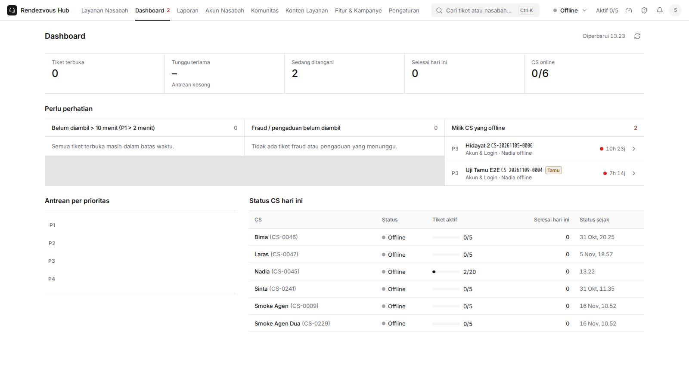
*Dashboard: ringkasan antrean, tiket yang perlu perhatian, dan status setiap CS hari ini.*

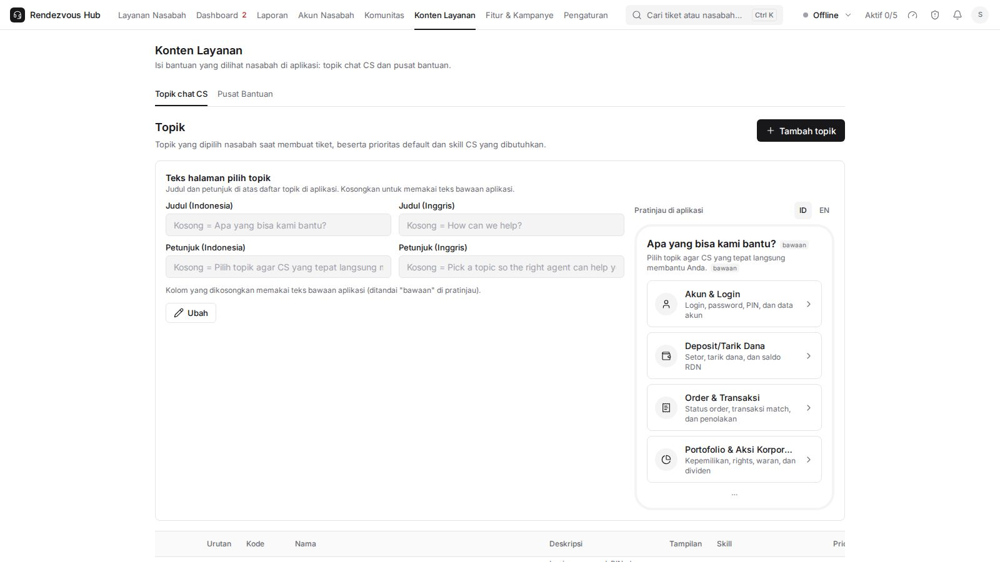
*Pusat Bantuan → Topik chat CS, dengan pratinjau tampilan di aplikasi.*

### 2.2 Fitur, kampanye, dan komunitas

| Menu | Deskripsi singkat |
|---|---|
| **Banner & Popup** | Kampanye banner strip dan popup promo: jadwal, platform, prioritas, gambar, tombol CTA, frekuensi, serta statistik tampil, klik, dan tutup. Banner baru bisa sekaligus dikirim sebagai notifikasi info ke semua nasabah sasaran, dengan halaman info di aplikasi dan empat mata opsional |
| **Komunitas → Postingan resmi** | Postingan dan pengumuman resmi dengan persetujuan empat mata, jadwal terbit, dan sematan |
| **Komunitas → Notifikasi** | Kampanye notifikasi atau push ke segmen nasabah, dengan statistik dibuka dan diketuk |
| **Komunitas → Moderasi** | Antrean laporan, konten dan gambar yang ditahan, indikasi manipulasi pasar, banding, dan sanksi user |
| **Komunitas → Room saham** | Slow mode, pin pesan, dan moderator room |
| **Komunitas → Indeks** | Kelola daftar indeks dan instrumen untuk tab filter Stream |
| **Komunitas → Akun resmi** | Kelola foto, nama, dan pratinjau akun resmi, dengan audit setiap perubahan |
| **Komunitas → Fitur & versi** | Nyala/matikan fitur sosial, kill switch, dan versi minimum aplikasi per platform |
| **Komunitas → Tab Stream** | Nyalakan atau matikan empat tab bawaan Stream (Terbaru, Teratas, Grafik & Media, Polling) |
| **Analitik** | Statistik pemakaian fitur sosial, filter Stream, dan notifikasi |

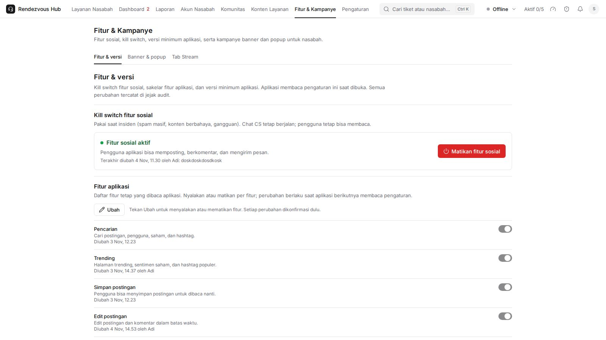
*Komunitas → Fitur & versi: kill switch fitur sosial dan sakelar per fitur, semuanya tercatat di jejak audit.*

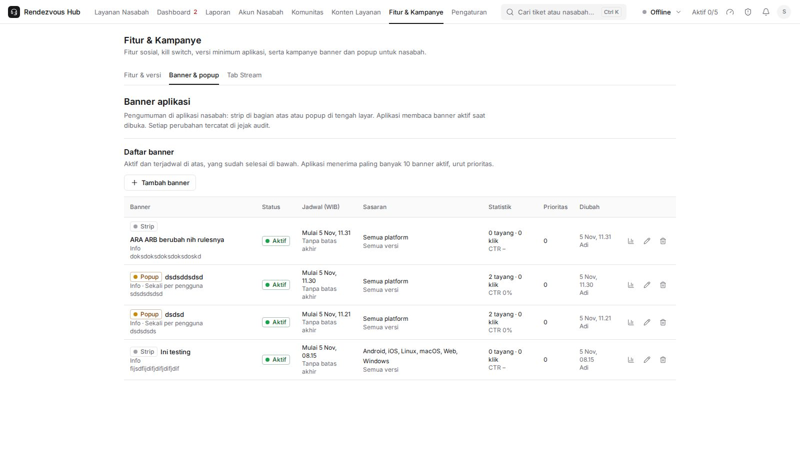
*Banner & Popup: daftar kampanye dengan jadwal, sasaran platform, statistik tayang/klik/CTR, dan prioritas.*

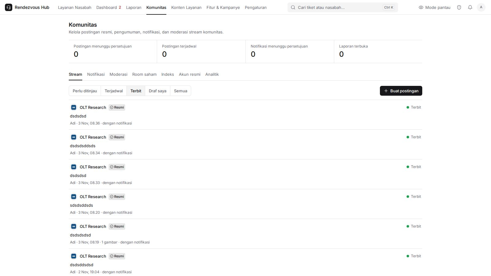
*Komunitas → Postingan resmi: postingan resmi per status (perlu ditinjau, terjadwal, terbit, draf).*

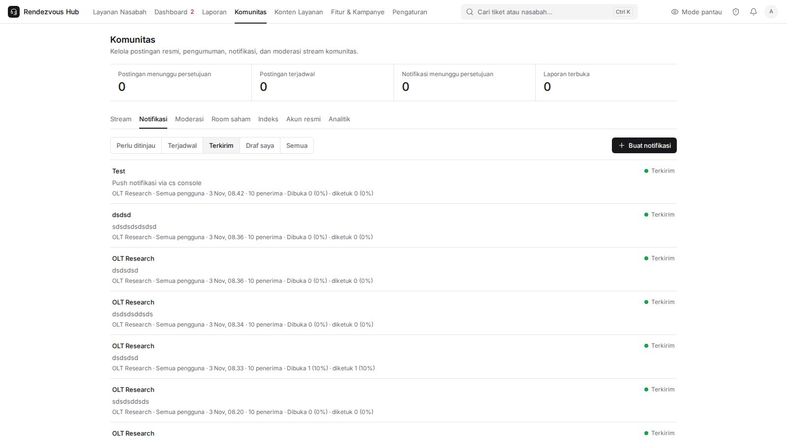
*Komunitas → Notifikasi: kampanye notifikasi dengan jumlah penerima, dibuka, dan diketuk.*

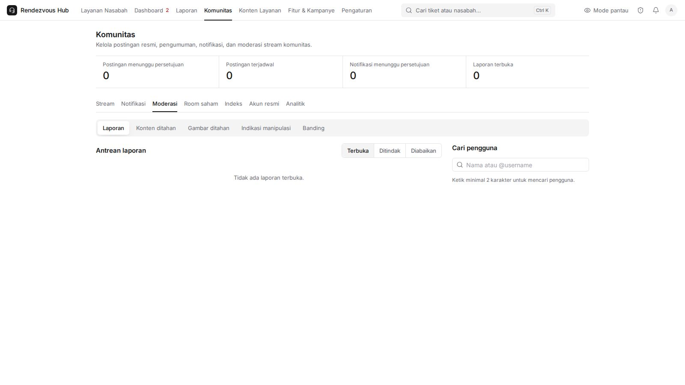
*Komunitas → Moderasi: laporan, konten dan gambar ditahan, indikasi manipulasi, dan banding.*

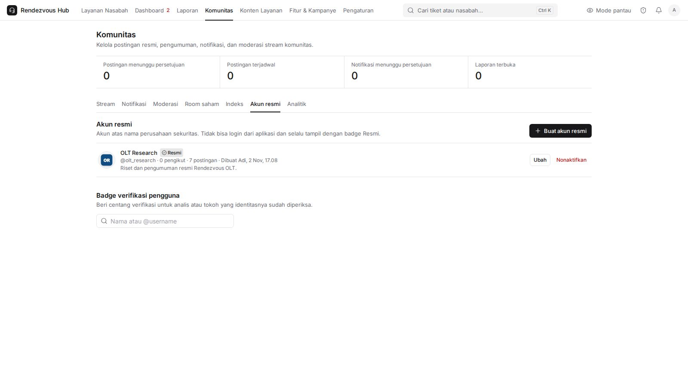
*Komunitas → Akun resmi dan badge verifikasi pengguna.*

### 2.3 Kepatuhan

| Menu | Deskripsi singkat |
|---|---|
| **Ringkasan & Kasus** | Kasus yang perlu ditinjau dan tiket yang ditandai |
| **Jejak Audit** | Semua aksi staf tercatat dan bisa ditelusuri |
| **Kebijakan & Kata terlarang** | Aturan konten, daftar kata terlarang, dan ambang pemindai gambar |
| **Dokumen hukum** | Draf S&K dan kebijakan, persetujuan sebelum terbit, dan riwayat versi |
| **Bukti** | Karantina bukti konten untuk keperluan hukum |
| **Akses tiket** | Kepatuhan bisa membuka tiket hanya-baca selama 12 jam, dan akses itu tercatat |
| **Berbagi Trade** *(dijeda)* | Persetujuan trader dan pengawasan aktivitas |

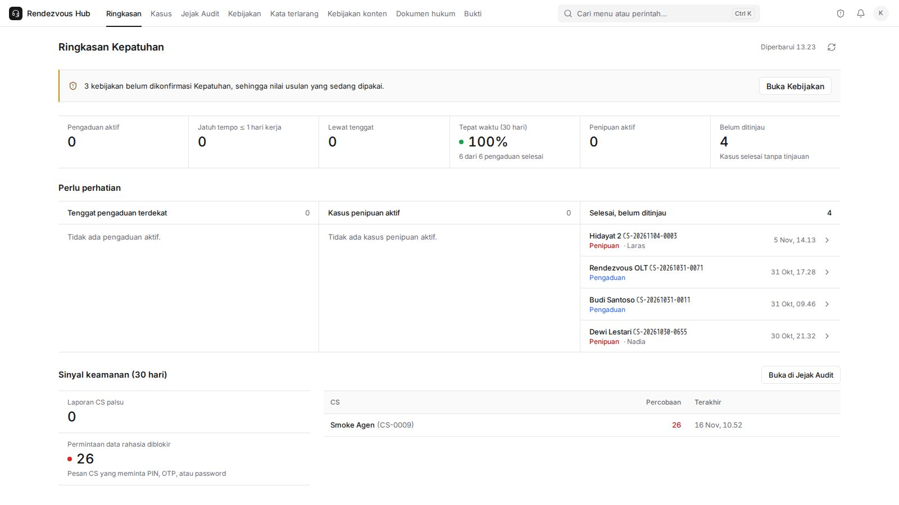
*Ringkasan Kepatuhan: pengaduan, kasus penipuan, kasus yang belum ditinjau, dan sinyal keamanan.*

### 2.4 Pengaturan dan sistem

| Menu | Deskripsi singkat |
|---|---|
| **Pengaturan → Layanan CS** | Akun CS (peran dan batas tiket), quick reply, label tiket, jam layanan dan libur, pesan otomatis, aturan lampiran, penugasan dan alert, status gangguan, survei kepuasan |
| **Pengaturan → Komunitas** | Izin komunitas per staf (5 izin) dan jam ringkasan watchlist |
| **Pengaturan → Integrasi** | Gateway csAdmin, koneksi aplikasi OLT (token sosial), API key integrasi, dan kunci Firebase untuk push |
| **Pengaturan → Sistem** | Kesehatan sistem (peta layanan realtime, status layanan, healer), backup, dan alert |
| **Akun staf** | Profil saya, Kinerja saya, ganti password, keluar dari semua perangkat; beberapa akun bisa dibuka di tab berbeda |
| **Umum** | Command palette (cari tiket, nasabah, menu), dua bahasa ID/EN, dan mode gelap |

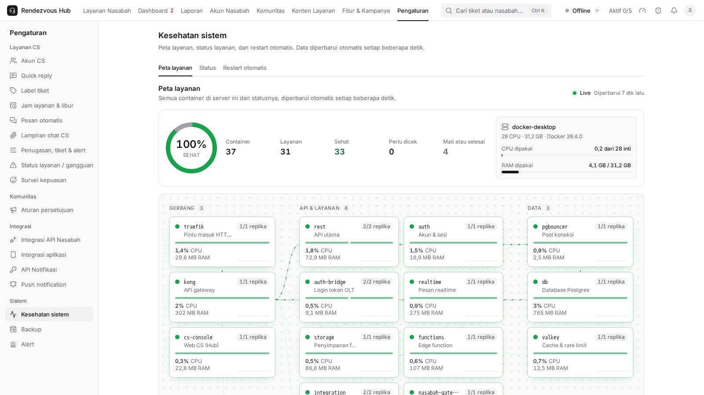
*Pengaturan → Sistem → Kesehatan sistem: peta layanan realtime dengan status, replika, CPU, dan RAM setiap layanan.*

## 3. Layanan server

| Layanan | Fungsi |
|---|---|
| **auth-bridge** | Menukar token sosial dari OLT menjadi sesi komunitas |
| **media, classifier, ClamAV** | Unggahan file, pemindaian gambar NSFW, dan pemindaian virus |
| **link-preview** | Membuat pratinjau tautan dengan aman |
| **notifier** | Mengirim push ke HP lewat Firebase |
| **integration** | API untuk sistem OLT: notifikasi transaksi dan bot resmi |
| **finreport** | Ringkasan otomatis laporan keuangan emiten dari file XBRL bursa, diposting sebagai postingan resmi setelah disetujui |
| **nasabah-gateway** | Jembatan aman dari Hub ke csAdmin OLT |
| **janitor** | Membersihkan file milik akun yang dihapus |
| **backup** | Backup otomatis database dan file, serta pemulihan ke titik waktu tertentu |
| **sentinel, healer** | Pemantauan, alert, pemulihan otomatis container, dan data peta layanan |
| **trade-relay** *(dijeda)* | Menerima data order match untuk Berbagi Trade |

## 4. Integrasi ke aplikasi OLT

| Titik integrasi | Deskripsi singkat |
|---|---|
| **Login (token sosial)** | Backend OLT menerbitkan token sosial bertanda tangan (maks. 15 menit); library menukarnya sendiri ke auth-bridge |
| **Pasang widget** | Stream, tab Diskusi di halaman saham, Chat, lonceng notifikasi, Chat CS, Pusat Bantuan, profil, pencarian, trending, bookmark. Semua berupa widget tanpa `Scaffold`, jadi layout tetap milik OLT |
| **Data saham** | `stockSearch`, `stockInfo`, dan `onStockTap` memakai data dan layar saham OLT; server hanya menyimpan kode saham |
| **Banner & popup** | Pasang `CommunityBannerHost` dan `CommunityPromoPopupHost`; deep link promo diteruskan ke router OLT |
| **Push** | `registerPushToken`. Push transaksi (`olt.*`) dibuka oleh layar OLT, push komunitas oleh library |
| **API notifEngine** | `POST /integration/v1/notify/messages` untuk notifikasi transaksi, dana, pasar, info, dan promo dari sistem OLT ke nasabah, per nasabah atau siaran |
| **Bot resmi** | `POST /integration/v1/bot/posts` agar sistem OLT bisa memposting otomatis atas nama akun resmi |
| **Laporan keuangan** | `POST /integration/v1/financial-reports` untuk mengirim file XBRL laporan keuangan emiten; ringkasannya menjadi postingan resmi di Stream setelah disetujui staf |
| **Pengaduan tamu** | Tombol "Tidak bisa masuk? Hubungi CS" di halaman login memanggil `openCommunityGuestSupport` |
| **Kill switch & update paksa** | `appVersion` dan `onUpdateRequired` agar Hub bisa memaksa update atau mematikan fitur sosial |
| **Gateway csAdmin** | Hub memanggil csAdmin OLT dengan token Ed25519, hanya untuk endpoint `/online/*` |
| **Logout & hapus akun** | `signOut()` dan `deleteMyAccount()` menghapus cache lokal; file lampiran ikut dibersihkan server |

Rincian teknis integrasi ada di [olt-integration.md](../olt-integration.md), [integration/](../integration/README.md), dan [rendezvous-community/](../rendezvous-community/README.md).
